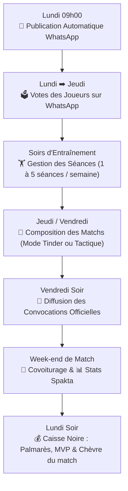

# 📖 Guide d'Utilisation au Quotidien - Handball Bot (v2.2)

Bienvenue dans le guide pratique d'utilisation de **Handball Bot** !  
Ce document détaille le fonctionnement complet de l'application au quotidien pour les **joueurs**, les **entraîneurs** et les **trésoriers**.

> [!TIP]
> Pour une présentation visuelle détaillée de toutes les capacités (Terrain 2D, Spakta, Caisse Noire, Vacances scolaires, PWA, Chiffrement...), consultez également le **[🌟 Guide Complet des Fonctionnalités (FONCTIONNALITES.md)](FONCTIONNALITES.md)**.

---

## 📅 Le Rythme Hebdomadaire d'une Semaine Type

---

## 🗂️ Les 5 Onglets du Carnet de Coach

L'application est structurée sous la forme d'un carnet de terrain avec **5 onglets intercalaires** accessibles en haut de l'écran :

1. **👤 Mon Profil** : Espace personnel du joueur connecté (photo, poste, statut, statistiques officielles Spakta, consultation de son ardoise).
2. **🤾 Matchs** : Composition des 1 à 3 équipes pour le week-end (Mode Tactique, Mode Tinder, Terrain 2D, renforts et convocation WhatsApp).
3. **🏃 Entraînements** : Gestion des séances de la semaine (1 à 5 séances modulables, répartition en groupes, présence et convocations).
4. **🏆 Vie d'Équipe** : Caisse Noire & Amendes (cagnotte, ardoises, barème, palmarès), covoiturage et déclarations d'absence.
5. **⚙️ Coach** : Trombinoscope complet de l'effectif, attribution des rôles (Trésorier, Chouchou, MVP, Chèvre), notes tactiques privées, gestion des collectifs et couleurs.

---

## 📲 Côté Joueurs : Simple, Rapide et sans Application

Les joueurs n'ont rien à installer : tout se fait directement depuis **WhatsApp** et via le **Portail Web mobile PWA**.

### 1. Voter au sondage WhatsApp hebdomadaire
- Chaque lundi matin, le bot publie automatiquement le sondage dans le groupe de l'équipe.
- Le joueur sélectionne en 2 secondes :
  - Ses disponibilités pour les matchs du week-end (*ex: 1B, 1C*).
  - Ses présences aux entraînements de la semaine (*Lundi, Mercredi, Jeudi*).
- S'il a un contretemps, il peut modifier son vote directement sur WhatsApp avant la clôture.

### 2. Accéder à son Espace Joueur personnel
1. Le joueur ouvre le lien de la WebApp sur son smartphone.
2. Il entre son **numéro de téléphone** (format `06...` ou `07...`).
3. **Première connexion** : il définit son **Code PIN secret** (4 à 8 chiffres).
4. Il accède à sa fiche personnalisée :
   - 🤾 **Choix de son poste de prédilection** (*Gardien, Demi-Centre, Pivot, Ailiers, Arrières*).
   - 📷 **Photo de profil** : prise d'un selfie ou import depuis la galerie photo. La photo est automatiquement recadrée et apparaît sur sa carte de composition et son badge de match.
   - 🏖️ **Signaler une absence / Indisponibilité** : déclaration des périodes de blessure, travail ou vacances pour avertir le coach en amont.

### 3. Consulter ses Statistiques Officielles Spakta (2026-2027)
Dès qu'un joueur est connecté, sa tuile **« 📊 Mes Stats Officielles (2026–2027) »** affiche ses performances issues de **Spakta Scout** et de la **FFHB** :
* **Badge N° de maillot officiel** : son numéro de maillot officiel (ex: `#55`) affiché en permanence.
* **Joueur de champ** :
  * Buts totaux marqués
  * Moyenne de buts par match
  * Pourcentage de réussite aux tirs
  * Jets de 7m réussis
  * Matchs officiels joués
  * Discipline (exclusions 2 min)
* **Gardien de but** :
  * Nombre total d'arrêts
  * Moyenne d'arrêts par match
  * Nombre de matchs joués
  * Arrêts réalisés sur la dernière rencontre disputée
* **Historique match par match** :
  * En cliquant sur **« 📅 Historique match par match »**, le joueur déroule toutes les rencontres de la saison avec la date, l'adversaire (ex: *vs Stade de Vanves*), le score final et ses statistiques individuelles du match.
  * Les statistiques consolident automatiquement les performances multi-collectifs (ex: badge officiel `ÉQUIPE 1C & 1B`).

### 4. Consulter son Ardoise et la Caisse Noire
Dans l'onglet **🏆 Vie d'Équipe** :
* **Mon Ardoise** : Le joueur consulte en direct ses amendes personnelles, la date, le motif précis et le montant restant dû.
* **Cagnotte de l'équipe** : Visualisation du montant total récolté et de l'avancement vers l'objectif de fin d'année (ex: *Resto de fin de saison*).
* **Barème** : Accès au barème officiel des infractions du vestiaire (retard, oubli de maillot, carton bête, chèvre du match...).
* **Règlement** : Bouton pour copier en 1 clic les coordonnées de paiement (Lydia, virement ou espèces).

---

## 👑 Côté Entraîneurs : Le Dashboard Coach

Pour accéder aux fonctions d'entraîneur :
1. Sur la page d'accueil de la WebApp, connectez-vous avec votre numéro (répertorié dans la cellule `Configuration!C25` ou dans l'Effectif avec le rôle d'entraîneur).
2. Le bandeau **👑 Espace Coach Déverrouillé** apparaît avec les outils de composition et d'administration.

---

## 🤾 1. Composer les Équipes de Match

L'application gère de **1 à 3 équipes** simultanées configurées pour votre club (*ex: 1B, 1C*).

### Le Mode Tinder (Swipe ultra-rapide) :
Idéal pour composer les équipes sur son smartphone dans les transports ou au vestiaire :
* **1 équipe** : 👈 Gauche = Repos | 👉 Droite = Retenu en Équipe 1
* **2 équipes** : 👈 Gauche = 🟡 Équipe 1 | 👉 Droite = 🟢 Équipe 2 | 👇 Bas = Repos
* **3 équipes** : 👆 Haut = 🟡 Équipe 1 | 👈 Gauche = 🟢 Équipe 2 | 👉 Droite = 🔵 Équipe 3 | 👇 Bas = Repos
* Boutons tactiles sous la carte pour les entraîneurs préférant cliquer plutôt que swiper.

### Le Mode Tactique (Tableau & Glisser-Déposer) :
* Affichage en colonnes : **Vivier de disponibles**, **Équipe 1**, **Équipe 2**, **Équipe 3** et **Joueurs au repos**.
* Glisser-déposer fluide des cartes de joueurs entre les colonnes.
* Compteurs de quota en temps réel (ex: `14 / 14 joueurs`).
* Bouton **« + Renfort »** permettant d'intégrer en un clic un joueur hors sondage ou issu d'une autre catégorie.

### Le Terrain Tactique 2D :
* Visualisation d'un demi-terrain de handball réglementaire avec placement aux 7 postes d'attaque + gardien dans les cages.
* Banc de remplaçants interactif pour ajuster le 7 majeur avant diffusion.

### Publication de la Convocation Officielle :
1. Cliquez sur **👁 Preview WhatsApp**.
2. Le message officiel est généré instantanément avec :
   - Nom des équipes et adversaires détectés sur le site officiel FFHB.
   - Gymnases, adresses et heures de coup d'envoi.
   - Heures de rendez-vous calculées selon votre délai configuré (domicile / extérieur).
   - Liste ordonnée des joueurs convoqués par équipe (avec leur poste).
3. Cliquez sur **📤 Publier sur WhatsApp** pour diffuser instantanément dans le groupe d'équipe !

> [!NOTE]
> Les joueurs non retenus / au repos restent visibles uniquement sur la WebApp et dans le tableur. Ils ne sont **pas mentionnés** dans le message WhatsApp public afin de préserver les ego et la cohésion de vestiaire.

---

## 🏃 2. Gérer les Séances d'Entraînement

La WebApp permet de configurer de **1 à 5 séances par semaine** et s'adapte à la réalité du terrain avec 3 formats :

| Type de Séance | Description | Usage type |
| :--- | :--- | :--- |
| **🔀 Entraînement Séparé** | Répartition des joueurs en 2 groupes distincts | Lundi (ex: Équipe 1 vs Équipe 2, ou Avants vs Arrières) |
| **🎯 Effectif Réduit** | Quota maximum de joueurs retenus | Jeudi (séance tactique fermée max 16-18 joueurs) |
| **👥 Effectif Complet** | Tous les joueurs disponibles sont automatiquement retenus ensemble | Mercredi (séance ouverte à tous les présents) |

* Choix du mode de travail : **Glisser-Déposer** ou **Mode Tinder**.
* Génération de la convocation d'entraînement avec compteurs et liste ordonnée.
* Envoi WhatsApp en 1 clic et archivage dans Google Sheets.

---

## 💰 3. Gérer la Caisse Noire & les Amendes

Le folklore et la trésorerie de vestiaire sont administrés depuis l'onglet **🏆 Vie d'Équipe** :

* **Déléguer au Trésorier** : Dans l'onglet Coach, cochez la case **⭐ Trésorier de la Caisse Noire** sur la fiche d'un joueur. Ce joueur aura désormais accès à la gestion de la caisse noire sans avoir accès aux décisions tactiques.
* **Infliger une amende** : Sélectionnez un joueur, choisissez l'infraction dans le barème (ou saisissez un montant libre) et validez.
* **Encaisser un paiement** : Marquez une amende comme réglée dès réception du virement Lydia ou des espèces.
* **Palmarès** : Consultez le tableau d'honneur des plus gros contributeurs de la caisse.
* **Chèvre & MVP du match** : Désignez la Chèvre et le MVP du week-end directement sur leur fiche joueur pour leur attribuer les bonus/malus de vestiaire !

---

## 🚗 4. Gérer le Covoiturage des Déplacements

Lors des matchs à l'extérieur :
* Les conducteurs renseignent leur nom, leur ville de départ et le nombre de places disponibles dans leur voiture.
* Les passagers s'inscrivent sur les véhicules disponibles en 1 clic.
* La répartition des voitures est consultable par tous sur la WebApp.

---

## 🏖️ 5. Gérer les Vacances Scolaires et Trêves

* L'application détecte automatiquement les semaines de vacances scolaires nationales (Toussaint, Noël, Hiver, Printemps).
* Lorsqu'une semaine est en période de vacances et qu'aucun match officiel FFHB n'est programmé, une bannière bleue s'affiche :  
  `🏖️ Semaine en période de vacances scolaires (Vacances de la Toussaint) : pas de match officiel programmé.`
* Le bouton **« Gérer vacances »** permet au coach d'activer ou désactiver manuellement la trêve si des séances amicales ou des rattrapages ont lieu.

---

## 🎨 6. Personnaliser le Club & les Couleurs

1. Cliquez sur **🎨 Couleurs & Équipes** dans l'onglet Coach.
2. **Synchronisation Page Club FFHB** :
   - Collez l'URL de votre club sur `monclub.ffhandball.fr`.
   - Cliquez sur **⚡ Importer** : le blason officiel et les couleurs dominantes sont automatiquement extraits et appliqués !
3. **Nombre d'Équipes gérées** :
   - Basculez entre **1 Équipe**, **2 Équipes** ou **3 Équipes** selon votre configuration de championnat.
   - Les modes Tactique et Tinder s'adaptent immédiatement.

---

## 💡 Conseils & Astuces au Quotidien

* **Actualisation WhatsApp en direct** : Si des joueurs ont voté tardivement sur WhatsApp, cliquez sur le bouton **📥 Actualiser WhatsApp** dans l'en-tête pour synchroniser les nouveaux votes sans recharger la page.
* **Changer de thème** : Cliquez sur le bouton de thème dans le header pour basculer entre le **Carnet de Coach** (papier millimétré), le **Mode Clair** et le **Mode Sombre** (ardoise vestiaire).
* **Hors-Ligne & Cache** : L'application fonctionne même sans réseau dans le sous-sol d'un gymnase grâce à son cache local PWA et son architecture Stale-While-Revalidate.
* **Installation PWA** : Sur mobile (Safari iOS ou Chrome Android), cliquez sur « Ajouter à l'écran d'accueil » pour utiliser l'application en plein écran comme une application native.
